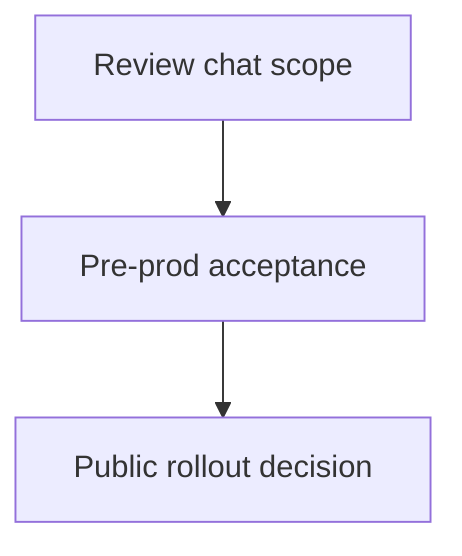

# Aroha Retreat roadmap

[Website](https://aroharetreat.com) · [Release notes](releases.md) · [GitHub Roadmap](https://github.com/orgs/ArohaRetreat/projects/1/views/4)

Schedule snapshot from 13 November 2026. The windows below are targets for review and testing. See the [release notes](releases.md) for availability by environment.

## Scheduled reviews

- **16–29 November 2026** — Prepare pre-prod for staff review. Check that hosts can safely edit test content, that booking API tests use independent fixtures, and that the test site stays within its Firebase budget. [Website changes](https://github.com/ArohaRetreat/website/issues/93), [API test isolation](https://github.com/ArohaRetreat/website/issues/126), [Firebase usage](https://github.com/ArohaRetreat/website/issues/130).
- **30 November–13 December 2026** — Verify the booking journey on pre-prod for staff and guests. Cover booking, arrival and checkout, plus emails, invoices and walk-ins. [Booking acceptance](https://github.com/ArohaRetreat/website/issues/101), [Host Studio](https://github.com/ArohaRetreat/website/issues/111), [Booking lifecycle](https://github.com/ArohaRetreat/website/issues/70).
- **14–27 December 2026** — Review the public website and Living Map on the intended devices. Cover guest navigation, Google sign-in and the host content workflow. [Website acceptance](https://github.com/ArohaRetreat/website/issues/2), [Living Map acceptance](https://github.com/ArohaRetreat/website/issues/4).

## Hrudhi AI

**Planning.** Hrudhi AI would help website visitors find information about stays, day visits and the Living Map through English text chat. The [epic](https://github.com/ArohaRetreat/website/issues/157) has no scheduled sprint or launch date.

1. Review the chat scope, public information sources, privacy and operating budget. [Hrudhi AI plan](https://github.com/ArohaRetreat/website/issues/157)
2. In pre-prod, verify answer quality, navigation links and Dynatrace telemetry using synthetic questions. [Acceptance criteria](https://github.com/ArohaRetreat/website/issues/162)
3. Review that evidence before approving availability for website visitors. [Rollout criteria](https://github.com/ArohaRetreat/website/issues/162)

The later Arize evaluation work depends on Dynatrace telemetry acceptance. [Arize follow-up](https://github.com/ArohaRetreat/website/issues/163)
